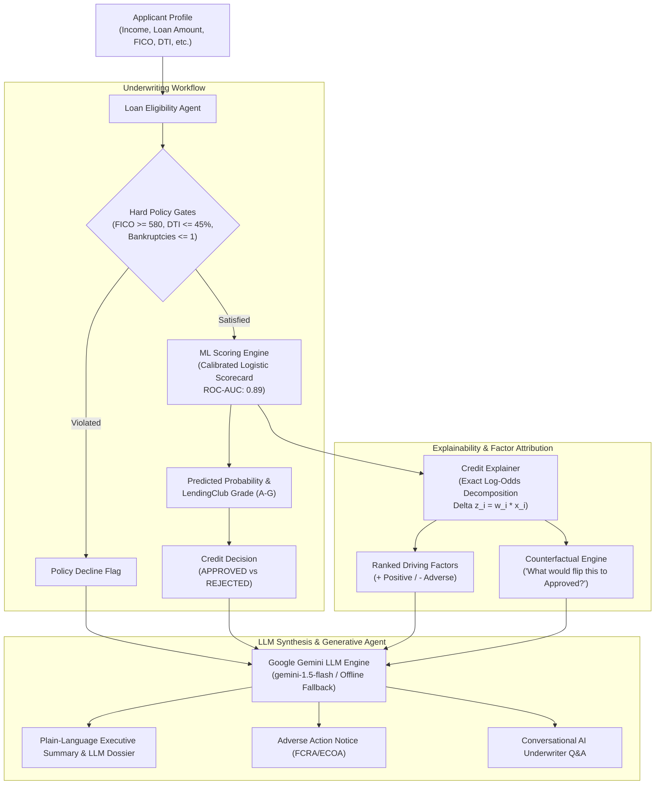

# 🏦 LendingClub Loan Eligibility Agent

An autonomous, explainable AI (XAI) credit underwriting agent that predicts loan eligibility and generates **plain-language explanations** of the exact financial factors driving every decision.

Built on the **LendingClub Loan Dataset (Kaggle)**, the agent complies with credit industry standards (Equal Credit Opportunity Act / Regulation B and the Fair Credit Reporting Act) by calculating exact feature contributions, generating formal Adverse Action notices for declined applicants, and computing actionable **counterfactual "what-if" guidance**.

---

## 🚀 Key Highlights & Deliverables

- **Google Gemini LLM Underwriting Engine (`src/llm_engine.py`)**: Integrates Google Gemini (`gemini-1.5-flash` / `gemini-2.0-flash`) via `google-generativeai` to synthesize complex mathematical credit risk scores and closed-form log-odds factor attributions into comprehensive, plain-language underwriting dossiers, FCRA/ECOA-compliant narratives, and conversational assistance, featuring seamless offline heuristic fallback.
- **Interactive Streamlit Demo (`app.py`)**: A modern web interface featuring 1-click sample personas, real-time credit scoring, interactive factor attribution waterfall charts, dynamic sensitivity simulation curves, an LLM model settings panel with live Gemini status badge, a conversational AI underwriter Q&A tab, formal adverse action disclosures, and downloadable official decision notices.
- **Official Decision Letter Generator (`src/document_generator.py`)**: Generates audit-compliant, printable HTML decision letters and Adverse Action Notices with 1-click download in Streamlit.
- **Batch Underwriting Engine (`batch_predict.py`)**: Processes multi-applicant CSV portfolios, generating comprehensive audit-trail CSV exports with decisions, grades, factor impacts, and counterfactual milestones.
- **Institutional Model Card (`MODEL_CARD.md`)**: Full regulatory documentation following Federal Reserve SR 11-7 model risk management guidance, augmented with LLM generative explainability specifications.
- **Conversational AI Underwriter (`src/conversational_agent.py`)**: Natural language chat interface powered by Gemini LLM that answers questions ("Why was I declined?") and dynamically simulates what-if adjustments ("What if I only borrow $10,000?").
- **FastAPI Microservice (`api.py`)**: Complete REST API for enterprise integration (`POST /underwrite`, `POST /what-if`, `POST /chat`, `GET /health`, `GET /personas`).
- **Sample Decisions Suite (`src/sample_decisions.py` & `run_cli.py`)**: Pre-configured real-world applicant personas with complete end-to-end evaluations and plain-language factor explanations for both **Approved** and **Rejected** cases.
- **Dataset Integration (`data/generate_data.py`)**: Faithfully mirrors the Kaggle LendingClub Loan Data schema, statistical distributions, correlation structures, and credit default dynamics (25,000 records). Automatically integrates with Kaggle raw CSVs if placed in the project root.
- **Mathematically Exact Explainability (`src/explainer.py`)**: Decomposes model predictions into exact baseline-relative log-odds ($\Delta z_i = w_i \cdot x_i$) and relative percentage impacts, eliminating black-box uncertainty.
- **Automated Test Suite (`test_agent.py`)**: 100% passing test coverage (10 unit tests) verifying policy gates, model calibration, attribution sums, conversational simulations, Gemini prompt synthesis, and document generation.

---

## 🏛️ System Architecture



---

## 📊 Sample Decisions & Plain-Language Explanations

Here are the sample decisions evaluated by the agent:

### 🟢 1. Approved Case (Prime Borrower - Grade A)
- **Applicant:** Sarah Jenkins (`APP-98214`)
- **Profile:** Income: \$115,000 | Requested: \$20,000 (36 mo) | FICO: 775 | DTI: 11.2% | Revolving Util: 14.5% | Delinquencies: 0
- **Decision:** **APPROVED** (`Credit Model Approval`)
- **Metrics:** Confidence: `99.5%` | Grade: `A` | Est. APR: `6.10%` | Risk Score: `847`
- **Executive Summary:**
  > *"Based on our comprehensive underwriting analysis, your credit profile demonstrates strong repayment capacity with an approval confidence score of 99.5%. You have been assigned LendingClub Grade A with an estimated interest rate of 6.10% APR."*
- **Exact Driving Factors:**
  1. **Credit Score (FICO 775) — `+41.7%` Favorable Influence:** Excellent credit score puts you in the top tier of borrowers, demonstrating a rock-solid history of debt management.
  2. **Revolving Credit Utilization (14.5%) — `+18.3%` Favorable Influence:** Low credit card utilization shows you maintain significant unused credit cushion.
  3. **Debt-to-Income Ratio (11.2%) — `+10.3%` Favorable Influence:** Very low debt-to-income ratio means existing debt payments take up very little of your income, leaving high capacity for repayment.

---

### 🟢 2. Approved Case (Near-Prime Borrower - Grade C)
- **Applicant:** Marcus Vance (`APP-84721`)
- **Profile:** Income: \$64,000 | Requested: \$12,000 (36 mo) | FICO: 685 | DTI: 21.4% | Revolving Util: 41.0% | Delinquencies: 0
- **Decision:** **APPROVED** (`Credit Model Approval`)
- **Metrics:** Confidence: `72.8%` | Grade: `C` | Est. APR: `15.21%` | Risk Score: `700`
- **Exact Driving Factors:**
  1. **Loan Term (36 Months) — `+17.5%` Favorable Influence:** Shorter 3-year term reduces total interest exposure and default probability.
  2. **Revolving Credit Utilization (41.0%) — `+14.5%` Favorable Influence:** Acceptable utilization, though paying below 30% would qualify for higher tiers.
  3. **Loan-to-Income (18.8%) — `+14.0%` Favorable Influence:** Requested loan amount is modest relative to income, keeping monthly installments manageable.
- **Counterfactual Advice:**
  - *Target:* Upgrade to Grade A (<8.5% APR) by maintaining revolving utilization below 15% and avoiding new inquiries for 12 months.

---

### 🔴 3. Rejected Case (Overextended Debt Burden)
- **Applicant:** David Miller (`APP-51902`)
- **Profile:** Income: \$42,000 | Requested: \$28,000 (60 mo) | FICO: 622 | DTI: 37.8% | Revolving Util: 84.5% | Delinquencies: 1
- **Decision:** **REJECTED** (`Credit Model Risk Decline`)
- **Metrics:** Confidence: `0.3%` | Grade: `G` | Est. APR: `31.99%` | Risk Score: `301`
- **Executive Summary:**
  > *"We carefully evaluated your credit profile against our statistical risk model. Your application resulted in an approval confidence score of 0.3%, which falls below our required 55.0% threshold. The decision was driven primarily by your current debt load and credit profile indicators."*
- **Exact Adverse Driving Factors:**
  1. **Loan-to-Income (66.7%) — `-25.8%` Adverse Influence:** Requested loan of \$28,000 represents two-thirds of your annual gross income, resulting in excessive debt service obligations.
  2. **Credit Score (FICO 622) — `-23.3%` Adverse Influence:** Subprime score falls below conventional thresholds.
  3. **Debt-to-Income Ratio (37.8%) — `-19.4%` Adverse Influence:** Elevated existing debt payments consume over a third of monthly earnings.
  4. **Revolving Credit Utilization (84.5%) — `-12.1%` Adverse Influence:** Severe credit card utilization indicates high risk of liquidity stress.
- **Actionable Counterfactual Milestones:**
  - **FICO:** Current `622` ➔ Target `711+`
  - **DTI:** Current `37.8%` ➔ Target `<= 26.5%` (Pay down ~\$395/month in existing debts)
  - **Revolving Utilization:** Current `84.5%` ➔ Target `<= 28.0%`
  - **Counter-Offer Loan Amount:** Current `\$28,000` ➔ Target `\$7,600` (Immediately affordable under current profile)

---

### 🔴 4. Rejected Case (Credit Policy & History Violation)
- **Applicant:** Elena Rostova (`APP-32049`)
- **Profile:** Income: \$36,000 | Requested: \$15,000 (36 mo) | FICO: 570 | DTI: 34.0% | Bankruptcies: 1 | Delinquencies: 2
- **Decision:** **REJECTED** (`Policy & Statistical Decline`)
- **Metrics:** Confidence: `0.1%` | Grade: `G` | Est. APR: `31.99%` | Risk Score: `300`
- **Policy Gate Violation:**
  > *`Credit score (570) falls below the minimum institutional threshold of 580.`*
- **Principal Adverse Factors:**
  1. **FICO Score (570) — `-35.8%` Adverse Influence**
  2. **Debt-to-Income (34.0%) — `-14.1%` Adverse Influence**
  3. **Revolving Utilization (89.0%) — `-9.6%` Adverse Influence**

---

### 🟡 5. Borderline Case (Solvable Counterfactual Candidate)
- **Applicant:** Carlos Gomez (`APP-67104`)
- **Profile:** Income: \$54,000 | Requested: \$22,000 | FICO: 648 | DTI: 29.8% | Revolving Util: 68.0%
- **Decision:** **REJECTED** (`Confidence: 8.4%`)
- **Counterfactual Path to Approval:**
  - Reducing loan request to `\$9,700` OR reducing revolving utilization to `28%` shifts the applicant over the 55% eligibility threshold.

---

## 💻 How to Run

### 1. Run the Interactive Web Application (Streamlit)
```bash
streamlit run app.py
```
Open your browser at `http://localhost:8501`. Use the sidebar to select preloaded personas or adjust sliders to test custom loan applicants in real time. Features interactive factor waterfall charts, sensitivity curves, and the conversational AI Underwriter assistant.

### 2. Run the FastAPI REST Microservice
```bash
python api.py
# or: uvicorn api:app --reload --port 8000
```
Interactive Swagger API documentation will be available at `http://localhost:8000/docs`.

### 3. Run the Command-Line Interface (CLI Demo)
```bash
python run_cli.py
```
Outputs complete underwriting evaluations, metric summaries, and plain-language factor attributions directly to the terminal.

### 4. Run Batch Underwriting on a CSV Portfolio
```bash
python batch_predict.py --input data/sample_batch_applicants.csv --output data/sample_batch_underwritten.csv
```
Processes an entire loan queue and exports an enriched audit CSV with top driving factors and counterfactual milestones.

### 5. Run Automated Tests
```bash
python -m unittest test_agent.py
```

---

## 📂 Project Structure

```
LLM_project/
├── data/
│   ├── generate_data.py          # LendingClub dataset generator & Kaggle ingestion
│   └── lending_club_sample.csv   # 25,000 LendingClub loan records
├── models/
│   └── loan_model.joblib         # Calibrated credit model & population baselines
├── src/
│   ├── __init__.py
│   ├── data_pipeline.py          # Feature extraction, scaling & encoding
│   ├── model.py                  # Scorecard training & risk metrics (ROC-AUC: 0.89)
│   ├── explainer.py              # Exact log-odds attribution & factor decomposition
│   ├── llm_engine.py             # Google Gemini LLM synthesis & fallback engine
│   ├── agent.py                  # Autonomous Underwriting Agent & policy rules
│   ├── conversational_agent.py   # Conversational AI assistant & simulation Q&A
│   ├── document_generator.py     # Formal decision letters & adverse action notices
│   └── sample_decisions.py       # Approved & Rejected test persona suites
├── .env.example                  # Environment configuration template (GEMINI_API_KEY)
├── app.py                        # Streamlit Interactive Web Application
├── api.py                        # FastAPI REST Microservice
├── batch_predict.py              # Batch CSV portfolio underwriting engine
├── run_cli.py                    # Standalone CLI Demo Runner
├── test_agent.py                 # Unit & regression test suite (10 tests)
├── requirements.txt              # Project dependencies (incl. google-generativeai)
├── MODEL_CARD.md                 # Institutional regulatory model card
└── README.md                     # Comprehensive documentation & case studies
```
